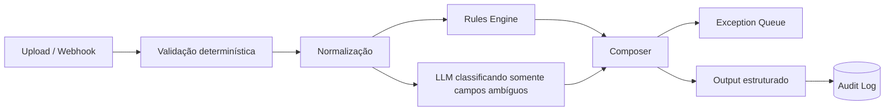

# OpsFlow AI

**Status:** lab demonstrativo criado para portfólio  
**Categoria:** Process Automation / AI Workflow

## Cenário
Uma equipe recebe arquivos CSV/Excel e eventos por webhook. Hoje uma pessoa valida colunas, procura inconsistências, categoriza exceções, consolida o resultado e envia um resumo.

## Solução proposta

## Princípios
- IA não valida aquilo que pode ser validado deterministicamente.
- Structured output obrigatório.
- Toda decisão importante registra inputs, versão e resultado.
- Baixa confiança vira revisão humana, não “chute”.
- Reprocessamento deve ser idempotente.

## Entrega vendável equivalente
Um projeto desse tipo pode ser vendido como **AI + Data Workflow**, começando por um processo pequeno e mensurando horas poupadas/retrabalho evitado.
