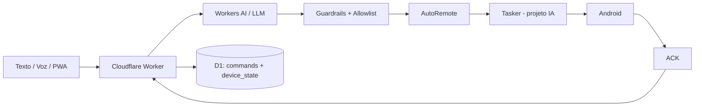

# Fold AI

**Status:** projeto pessoal real  
**Categoria:** AI Agent / Android Automation / Edge orchestration

## Problema
Assistentes mobile tradicionais respondem, mas frequentemente não executam sequências de ações personalizadas no aparelho de forma controlada. O objetivo foi criar um assistente próprio para Galaxy Z Fold capaz de interpretar português natural e executar ações permitidas sem depender de um APK monolítico.

## Arquitetura

## Decisões de engenharia
- Tasker funciona como **executor determinístico**; o LLM não recebe liberdade irrestrita no Android.
- Ações trafegam em protocolo estruturado (`ACTION`, `VALUE`, `EXTRA`).
- `request_id` identifica o pedido e `command_id` identifica cada ação.
- D1 persiste estado e histórico de comandos.
- O fluxo evolui para observar → decidir → executar → verificar → atualizar estado.
- Comandos sensíveis ficam condicionados a intenção explícita.
- Segredos ficam no Worker; nunca no frontend ou repositório.

## O que este projeto demonstra
- agent orchestration;
- tool calling com guardrails;
- integração cloud ↔ device;
- desenho de protocolo e ACK;
- estado persistente e idempotência;
- produto mobile-first/PWA.

## Próximos passos públicos
- suíte de evals de interpretação de comandos;
- simulação de falhas/retries;
- visualização de command trace;
- políticas por nível de risco da ação.
