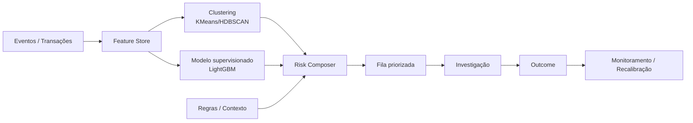

# Risk Intelligence Engine

**Status:** case sanitizado / dados sintéticos  
**Categoria:** Risk Analytics / Fraud Detection / ML

## Objetivo
Demonstrar uma arquitetura que combine **segmentação comportamental + scoring supervisionado + regras contextuais** para priorizar casos de risco com menos falsos positivos.

Nenhum dado, regra proprietária, threshold de produção ou informação de empregador é usado neste repositório.

## Arquitetura



## Features demonstrativas
- idade da conta;
- velocidade de eventos;
- quantidade de entidades relacionadas;
- concentração por dispositivo/rede;
- similaridade de padrão comportamental;
- desvio contra cluster de pares;
- recorrência de tentativa/saída;
- valor e frequência agregados.

## Estratégia
**Clustering** encontra estruturas e perfis sem exigir rótulo perfeito.  
**Modelo supervisionado** aprende sinais associados a outcomes conhecidos.  
**Regras** preservam controles determinísticos e contexto operacional.  
**Composição** evita depender de um único modelo e facilita explicabilidade operacional.

## Demo

```bash
cd demo
python -m venv .venv
source .venv/bin/activate  # Windows: .venv\\Scripts\\activate
pip install -r requirements.txt
python risk_engine.py
```

O script gera uma base sintética, cria clusters, treina um classificador e imprime métricas + exemplos de score.

## O que medir em produção
- precision / recall por faixa de score;
- taxa de falso positivo;
- captura por regra/modelo/cluster;
- volume enviado para revisão humana;
- estabilidade de features;
- drift de cluster e de score;
- tempo até detecção;
- custo operacional por caso útil.
