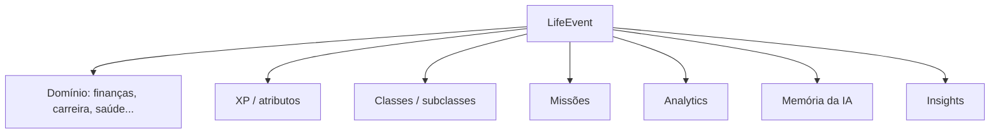

Aureon
Status: produto pessoal real em evolução  
Categoria: Android / Local AI / Personal OS / Gamification
Visão
Aureon é um RPG aplicado à vida real. O usuário registra acontecimentos, hábitos e objetivos; o sistema transforma esses eventos em progressão, atributos, classes, subclasses, missões, analytics e memória para um assistente local.
Princípio central
1 registro → N consequências.
Um `LifeEvent` funciona como backbone do produto:

Engenharia
Android/Capacitor com persistência SQLite local-first;
migrações incrementais e processamento idempotente;
fila única para operações críticas de banco;
backup local cifrado;
avatar e assets fora de blobs gigantes no SQLite;
downloads de modelo resilientes com retomada;
IA local como direção principal, com serviços externos opcionais;
testes de regressão para preservar dados em updates.
Produto
O projeto explora a interseção de:
gamificação de longo prazo;
personal analytics;
memória de agente;
local-first/privacy;
arquitetura orientada a eventos;
UX mobile para sistemas complexos.
O que este projeto demonstra
Capacidade de tratar um aplicativo não como conjunto de telas, mas como sistema de estado e consequências, preservando dados e consistência enquanto o produto evolui.
